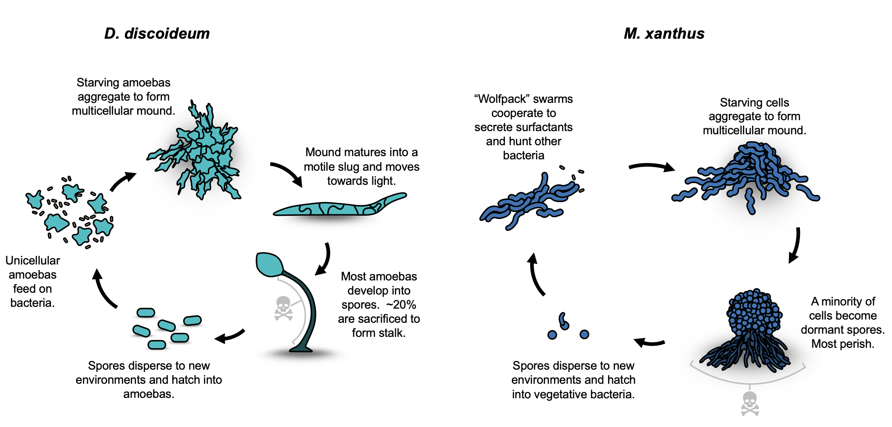

##### Download

 [PDF](paper1.pdf)


##### **Abstract**

Aggregative multicellularity occurs when dispersed cells join together to form a highly cooperative unit, in contrast to clonal multicellular organisms formed by cells that remain in contact after descent from a single cell. Because aggregative groups may include non-relatives, aggregative multicellular organisms should be particularly vulnerable to the rise of cheater cells that take advantage of social goods without paying the costs, reducing cooperation, and even threatening extinction. We review the key mechanisms by which aggregative multicellular organisms control cheaters with a focus on the best studied aggregative organisms, *Myxococcus xanthus* and *Dictyostelium discoideum*. These include various passive and active mechanisms to maintain high relatedness within aggregates, to enforce cooperation on aggregate members, and the costs of cheating on other key functions. Ultimately, aggregative multicellular organisms are not that different from clonal organisms descended from a single cell.


[//]: # (This is a comment)

[//]: # "And this is a comment"

[//]: # 'Also this is a comment'

[//]: # (Yet another comment)

[comment]: # (paper1.png)

[//]: # (Figure 1: Aggregative multicellularity in the social amoeba *Dictyostelium discoideum* and the pack hunting bacteria *Myxococcus xanthus*)

{#fig-1}


##### Citation

Jahan, Israt, Tyler Larsen, Joan E. Strassmann, and David C. Queller. "Group maintenance in aggregative multicellularity." In The Evolution of Multicellularity, pp. 111-134. CRC Press, 2022.

```BibTeX
@incollection{jahan2022group,
  title={Group maintenance in aggregative multicellularity},
  author={Jahan, Israt and Larsen, Tyler and Strassmann, Joan E and Queller, David C},
  booktitle={The Evolution of Multicellularity},
  pages={111--134},
  year={2022},
  publisher={CRC Press}
}

```

##### Related material


