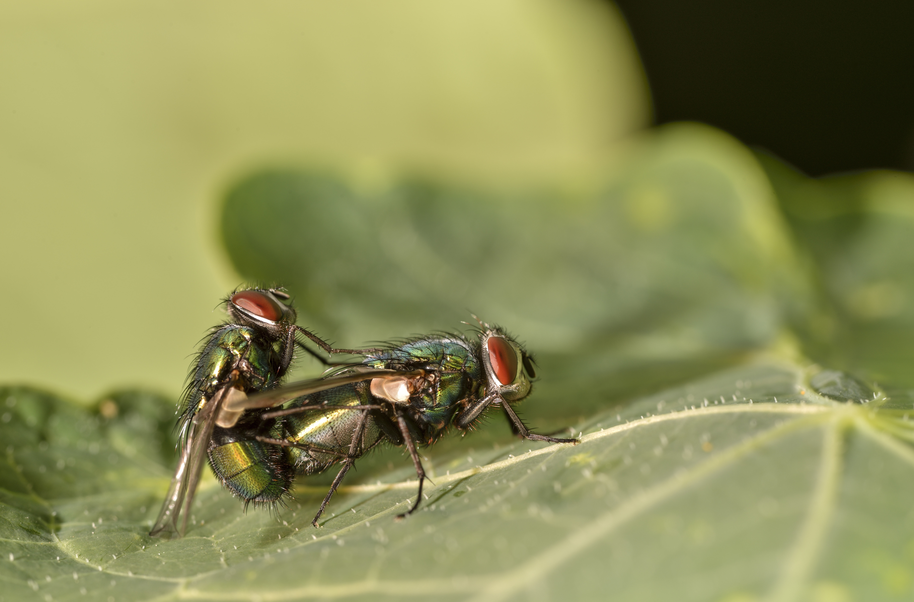
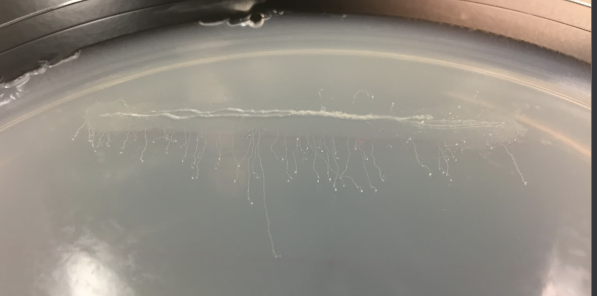

```{r setup}
source("_common.R")
```

<!-- Content for workshops I've given can be found at [workshops.jhelvy.com](https://workshops.jhelvy.com/) -->

<hr>

:::float-left

:::

### [BIO 472: Behavioral Ecology](https://en.wikipedia.org/wiki/Wikipedia:Wiki_Ed/Washington_University_in_St_Louis/Behavioral_Ecology_(Fall_2019))

**Instructor:** Professor Joan Strassmann

This was a graduate level course on the evolution of animal behavior taught by Professor Joan Strassmann. I was one of the three assistants to the instructor and led a discussion section of 13 upper level undergraduate students. We focused on social behaviors like aggression, mating, parental care, communication, and the complexities of living in groups and families. Throughout the semester, students contributed to Wikipedia pages and worked on writing and rewriting major entries of different *Dipteran* fly species. 

::: {.grid}

::: {.g-col-7}
One of my student's article on [*Drosophila subobscura*](https://en.wikipedia.org/wiki/Drosophila_subobscura) was nominated for the badge of a 'Good Article' for its factual accuracy and substantial improvement.
:::

::: {.g-col-5}

[**Wikipedia Articles**](https://dashboard.wikiedu.org/courses/Washington_University_in_St_Louis/Behavioral_Ecology_(Fall_2019)/articles/edited?)

- [Common green bottle fly](https://en.wikipedia.org/wiki/Common_green_bottle_fly)
- [Black salt marsh mosquito](https://en.wikipedia.org/wiki/Aedes_taeniorhynchus)
- [Caribbean fruit fly](https://en.wikipedia.org/wiki/Anastrepha_suspensa)
- [Black blow fly](https://en.wikipedia.org/wiki/Phormia_regina)

:::

:::

<br><hr>

:::float-left

:::

### [R for Statistical Analysis of Biological Data](https://)

This is a self-guided tutorial (WIP) for analyzing data from microbial fitness assays, including data input/output, data wrangling, and data visualization in R.

